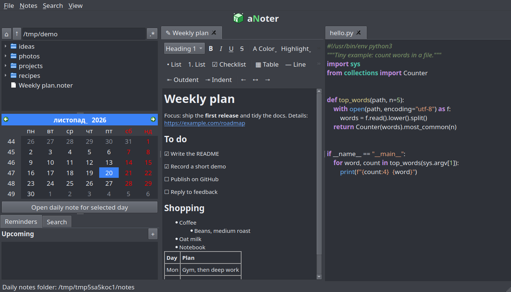

# aNoter

A small desktop notes app that works like a file commander: **your notes on the left, any
file on the right**, with a file explorer, a calendar and reminders on the side.
It is a single Python file (`Noter.py`) built on PyQt5.



## Features

- **Rich-text notes** (`.noter` files): headings, bold/italic/underline, colours and highlights,
  bullet / numbered / check lists, nested lists and indent, tables, horizontal lines,
  insert date and time stamps, clickable web links (Ctrl+click).
- **Any file on the right**: text and code with syntax highlighting (hundreds of languages),
  images (zoom, pan, animated GIF, SVG), and HTML files with a Source / Split / Browser view.
- **File explorer** on the left. Double-click a `.noter` file to open it as a note, any other
  file opens on the right.
- **Search**: find in the current tab, search all open tabs, the explorer folder, or daily notes.
- **Calendar and optional daily notes** (opened on demand, not created by default).
- **Reminders** with desktop notifications and a sound. They also fire when the window is
  closed, through a small background service.
- **Dark and light themes.**
- **Cursor Agent integration (optional)**: right-click text and choose *Request to Cursor Agent*
  or *Ask AI*. The request goes to the Cursor IDE (new Agent chat) or to the `agent` CLI in a
  terminal.

## Requirements

- **Linux** with a desktop session (developed and tested on Ubuntu / GNOME, Wayland and X11).
  It relies on Unix features (file locking for the background service), so Windows is not supported.
- **Python 3.8 or newer** (tested with 3.12).
- **PyQt5** (required).

Optional, each one only enables a feature:

| Package / tool | Used for | Debian / Ubuntu package |
| --- | --- | --- |
| Pygments | syntax highlighting in the right pane | `python3-pygments` |
| Pillow | extra image formats (WebP, TIFF, JPEG 2000, ...) | `python3-pil` |
| PyQt5 QtSvg | crisp SVG zoom | `python3-pyqt5.qtsvg` |
| PyQt5 QtWebKit | HTML "Browser" and "Split" view | `python3-pyqt5.qtwebkit` |
| `notify-send` | reminder notifications | `libnotify-bin` |
| `pw-play` or `paplay` (or `aplay`, `ffplay`, ...) | reminder sound | `pipewire-bin` / `pulseaudio-utils` |
| [Cursor](https://cursor.com) IDE and/or `agent` CLI | *Request to Cursor Agent*, *Ask AI* | n/a |

Without an optional package the app still starts; that feature is simply unavailable.

## Install

### Debian / Ubuntu (recommended)

```bash
sudo apt install python3-pyqt5 python3-pyqt5.qtsvg python3-pyqt5.qtwebkit \
                 python3-pygments python3-pil libnotify-bin
git clone https://github.com/AlexLisnitskiy/aNoter.git
cd aNoter
python3 Noter.py
```

### Other distributions, or a virtual environment

```bash
git clone https://github.com/AlexLisnitskiy/aNoter.git
cd aNoter
python3 -m venv .venv
. .venv/bin/activate
pip install -r requirements.txt
python3 Noter.py
```

Note: the PyQt5 wheel from PyPI does not include QtWebKit, so the HTML browser view needs your
distribution's `python3-pyqt5.qtwebkit` package (use `python3 -m venv --system-site-packages .venv`
to see it from a virtual environment). Everything else works with the pip packages.

## Run

```bash
python3 Noter.py                 # start with the last session
python3 Noter.py file1 file2     # open files (notes go left, others right)
python3 Noter.py --daemon        # headless reminder service only
```

To get an `aNoter` icon in your application menu and dock, use **File > Install app launcher...**
(it writes a `.desktop` file and icons under `~/.local/share`).

## Using it

| Action | Shortcut |
| --- | --- |
| New note (`.noter` file) | `Ctrl+N` |
| Open a file | `Ctrl+O` |
| Close tab | `Ctrl+W` |
| Today's daily note / selected day / previous / next | `Ctrl+T` / `Ctrl+D` / `Alt+Left` / `Alt+Right` |
| New reminder | `Ctrl+Shift+R` |
| Find in tab / next / previous | `Ctrl+F` / `F3` / `Shift+F3` |
| Search explorer folder / open tabs / daily notes | `Ctrl+Shift+F` / `Ctrl+Alt+O` / `Ctrl+Alt+D` |
| Focus explorer / notes / files | `Ctrl+1` / `Ctrl+2` / `Ctrl+3` |
| Show or hide the right pane / the explorer column | `F4` / `F9` |
| Checklist | `Ctrl+L` |
| Indent / outdent (also `Tab` in lists) | `Ctrl+]` / `Ctrl+[` |
| Insert date / time / both | `Ctrl+;` / `Ctrl+Shift+;` / `F5` |
| HTML file: Source / Split / Browser | `F6` |
| Open a link in a note | `Ctrl+click` |

Image tabs: `Ctrl+wheel` zooms, drag to pan, `0` fits to window, `1` shows actual size.

### Reminders when the window is closed

Turn on **Notes > Background reminders**. This installs a tiny autostart entry
(`~/.config/autostart/noter-reminders.desktop`) that runs `Noter.py --daemon` at login. Turn it off
in the same menu to remove it.

### Cursor Agent

**File > Cursor Agent settings...** chooses where requests run:

- **Cursor IDE**: opens a new Agent chat with your prompt through the IDE's `cursor://` link.
  The IDE asks you to confirm *Create Chat* before anything runs.
- **Terminal**: runs the `agent` CLI in a terminal window.
- **Automatic** (default): the IDE if it is installed, otherwise the terminal agent. Requests that
  are too long for the IDE link also use the terminal.

Leave the paths empty to detect Cursor automatically, or set them if it lives somewhere unusual.

## Where data is stored

Everything is under `~/.local/share/noter/` (change it with the `NOTER_HOME` environment variable):
`reminders.json`, `config.json`, and optional daily notes in `notes/YYYY-MM-DD.html`.
Your `.noter` files stay wherever you create them. Window layout and the settings above are kept
by Qt in `~/.config/noter/noter.conf`.

## Privacy

aNoter makes no network connections on its own and has no telemetry. The only things that leave
your machine are what you start yourself: opening a link in your browser, or sending a request
to Cursor.

## License

[MIT](LICENSE)
